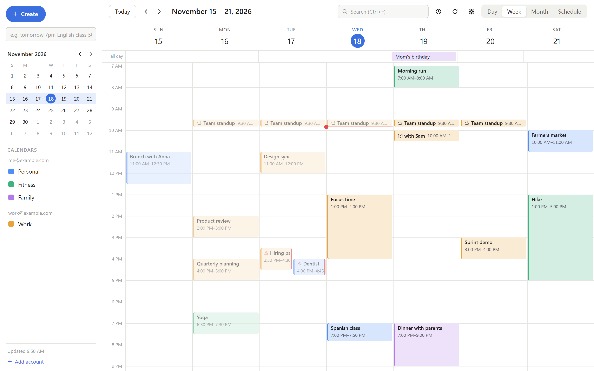
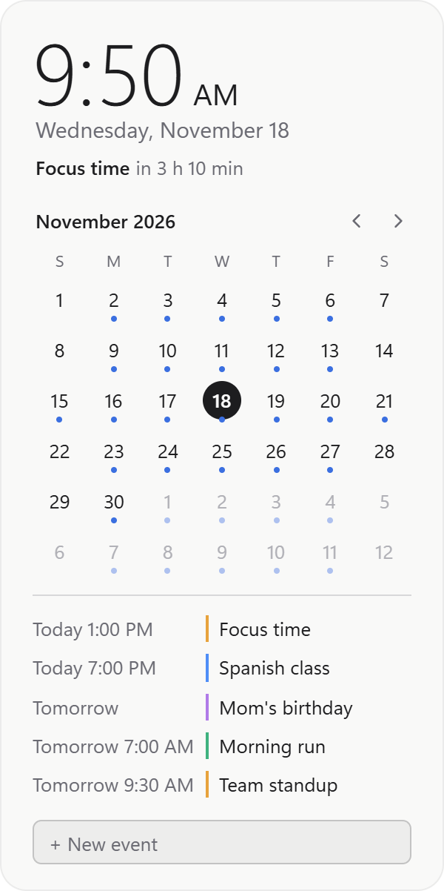
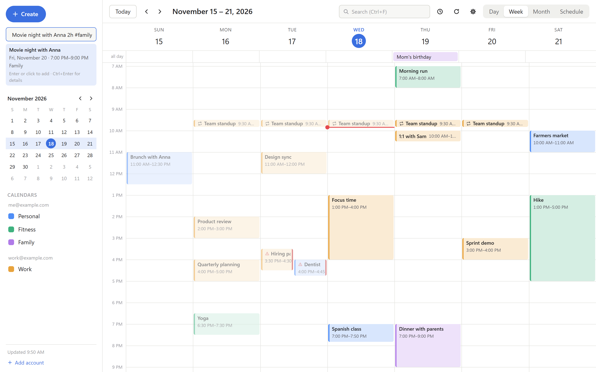

# Calm Calendar — Google Calendar app for Windows

**A free, ad-free desktop calendar for Windows 10 and 11 that works with your Google Calendar.** Day, week, month and schedule views, a desktop widget, quick add from one line in 13 languages, a Join button for Google Meet, Zoom and Teams, reminders as Windows notifications and a tray agenda.

[](https://github.com/Guck111/calm-calendar/releases/latest)
[](https://calmcalendar.co.uk)
[](https://github.com/Guck111/calm-calendar/releases/latest)
[](LICENSE)

**[⬇ Get it from Microsoft Store](https://apps.microsoft.com/detail/9N5HZ8P1QRMW)** · **[Installer on GitHub](https://github.com/Guck111/calm-calendar/releases/latest)** · **[Website](https://calmcalendar.co.uk)** · **[What's new](CHANGELOG.md)** · **[All features](docs/features.md)**



## Download and install

1. Install it from the [Microsoft Store](https://apps.microsoft.com/detail/9N5HZ8P1QRMW), or download `Calm.Calendar_…_x64-setup.exe` (or the `.msi`) from the [latest release](https://github.com/Guck111/calm-calendar/releases/latest) and run it.
2. Click "Sign in with Google" — sign-in happens in your browser, no setup needed.

The app is free, has no ads and no account of its own. Your events go straight between your computer and Google; nothing is sent to us. Details: [privacy policy](https://calmcalendar.co.uk/privacy.html).

## Why Calm Calendar

Google has no Calendar app for Windows, and the Windows Calendar and Mail apps are gone. Calm Calendar gives you Google Calendar as a real desktop app: it starts with Windows, lives in the tray, shows your day on the desktop and reminds you about meetings even when the browser is closed.

## Features

- **Views:** day, week, month and schedule; week numbers; holidays of 76 countries.
- **Events:** create, edit, drag and resize; recurring events ("this event" / "this and following"); guests, time zones, travel time.
- **Quick add:** type "lunch with Anna tomorrow 13:00" in one line — works in 13 languages, also from any app with `Ctrl+Alt+Space`.
- **Never miss a meeting:** a Join button for Google Meet, Zoom and Teams; Windows notifications; an optional hard-to-miss full-screen alert.
- **Desktop widget and tray agenda:** today and tomorrow at a glance.
- **Several Google accounts** in one window, with overlaps between them highlighted; .ics calendar subscriptions (Outlook, school, sports).
- **Free time as text** to paste into a messenger.
- **Five styles** (Classic, Paper, Obsidian, Showcase, Monochrome), each light and dark, a choice of fonts, a glass effect.
- **Works offline** with the last loaded weeks; keyboard-first with a `Ctrl+K` command menu.

| Desktop widget | Quick add |
| --- | --- |
|  |  |

The full list, by area, is in [docs/features.md](docs/features.md). What changed in each version: [CHANGELOG.md](CHANGELOG.md).

### 13 languages

English, Russian, Ukrainian, Belarusian, Spanish, French, Portuguese, German, Japanese, Chinese (Simplified), Hindi, Arabic (right to left) and Bengali — the interface and quick add. The language follows Windows and can be changed in Settings → Language. Dates follow the region: in en-US the week starts on Sunday and times use AM/PM.

### Keyboard shortcuts

`←` `→` previous and next, `T` today, `D` `W` `M` `A` day, week, month and schedule, `N` quick add, `Ctrl+K` command menu, `Ctrl+F` or `/` search, `Esc` close a form. `Ctrl+Alt+Space` opens quick add from any app (Settings). On an event: arrows move between events, `Enter` opens, `E` edits, `Ctrl+D` duplicates, `Delete` deletes. `?` shows all shortcuts. They work with the Russian keyboard layout too.

## Development

Stack: Tauri 2 (Rust), React 19, TypeScript, Effector, CSS Modules. Dates use plain `Date` and `Intl`, no date libraries. Everything below is for building the app yourself; release builds already include the Google sign-in client.

### How sign-in works

- Sign-in happens in the system browser. The app receives the code on `127.0.0.1` and uses PKCE.
- The refresh token is stored in Windows Credential Manager (Keychain on macOS), not in a file.
- Tokens never reach the web view: the Rust side makes all Google Calendar API requests, the frontend sends only the path and parameters. Only `/calendar/v3/…` paths are allowed.
- Scopes: `calendar.calendarlist.readonly` (calendar list) and `calendar.events` (events), plus `openid email` to show the account address.

### Google Cloud setup (once)

1. Open [console.cloud.google.com](https://console.cloud.google.com) and create a project.
2. APIs & Services → Library → **Google Calendar API** → Enable.
3. Google Auth Platform → Branding: app name, support email and developer contact email.
4. Audience: user type **External**. Then **Publish app** to move it to "In production"; verification is not required for personal use. In "Testing" status the sign-in expires every 7 days, and only test users can sign in.
5. Data Access → Add or remove scopes: add `.../auth/calendar.calendarlist.readonly` and `.../auth/calendar.events`.
6. Clients → Create client → **Desktop app** → create it and download the JSON.
7. Start the app and paste the whole JSON into the "Подключение к Google" form.

On first sign-in Google shows an "unverified app" warning: Advanced → Go to Calm Calendar. An unverified app can be used by up to 100 accounts over its lifetime.

If Publish app stays disabled even with Branding filled in, add your account under Audience → Test users. Others have reported the same issue on the Google developer forum.

The client file is stored at `%APPDATA%\com.arseni.calmcalendar\google-client.json`. For a Store build the client can be baked in at compile time with the `CALM_GOOGLE_CLIENT_ID` and `CALM_GOOGLE_CLIENT_SECRET` environment variables (repository secrets in CI).

### Building on Windows

One-time setup:

1. [Node.js](https://nodejs.org) LTS.
2. [Rust](https://rustup.rs) via `rustup-init.exe`.
3. Microsoft C++ Build Tools with the "Desktop development with C++" workload (the Rust installer offers it).
4. WebView2 ships with Windows 11.

Then:

```powershell
npm install
npm run tauri dev      # development mode
npm run tauri build    # installers in src-tauri\target\release\bundle\
```

`npm run dev:app` runs the app as `com.arseni.calmcalendar.dev`, with its own settings folder, web view data and Credential Manager entries. It runs next to the installed app and signs in through its own Google client from `%APPDATA%\com.arseni.calmcalendar.dev\google-client.json`, so development sign-ins stay out of the release client's statistics. A build without the CLI: `npm run build`, then in `src-tauri` `TAURI_CONFIG='{"identifier":"com.arseni.calmcalendar.dev"}' cargo build --features tauri/custom-protocol`.

### UI development in the browser

`npm run dev` serves the interface at http://localhost:1420 with mock calendars and events (`src/shared/api/mock.ts`). Open `/?window=widget` to see the widget. Mock data is not included in the app build.

#### Debug hooks

- `CALM_DEMO_AGENDA=1 npx tauri dev` opens the tray agenda without the tray.
- `CALM_DEMO_ALERT=1 npx tauri dev` shows the hard-to-miss alert without a Google event.
- `npm run dev`, then `/?crash=1` (or `/?window=widget&crash=1`) shows the window error screen. Only in the dev server.

### Releases

`main` takes changes only through pull requests, and only when the `test` (`ci` workflow) and `ts` (`mutation` workflow) checks are green: direct pushes, force pushes and deleting the branch are blocked by the "main: pull requests only" ruleset. Installers come from the `release` workflow:

1. On a branch, bump the version in `package.json`, `src-tauri/tauri.conf.json` and `src-tauri/Cargo.toml`, and move the "Unreleased" notes in `CHANGELOG.md` under the new version. The release workflow puts that section on the GitHub release page.
2. Open a pull request, merge it once the checks are green, then tag the merge commit on `main`: `git switch main`, `git pull`, `git tag v0.9.0`, `git push origin v0.9.0`.
3. In 10–15 minutes a release with `.exe` and `.msi` appears under Releases.

To build without a tag: Actions → release → Run workflow. The installers will be in that run's Artifacts.

### Checks

```powershell
npm test               # dates, event layout, quick add parser, reminders, forms
npx tsc --noEmit       # types
npx tsc -p e2e         # types of the end-to-end tests
cd src-tauri; cargo test
cargo clippy --all-targets -- -D warnings   # Rust lints; CI fails on any warning
```

#### Interface tests (Playwright)

`npm run test:ui` runs the UI flows in the installed Google Chrome against `npm run dev` with mock data (it starts the dev server itself, or uses one already on port 1420). The clock is fixed at Wednesday 11 November 2026, 9:50, Warsaw time, so every run sees the same week. Tests are in `e2e/ui/*.e2e.ts`: quick add in all 13 languages, the event card and form, drag and resize, recurring events, time zones, guests, travel time, free time, the views, week numbers, holidays, search, settings, sign-out, the window error screen, right-to-left Arabic and the widget page. They run in CI on every push. On a failure, `npx playwright show-trace test-results\…\trace.zip` replays it.

#### App tests (Edge WebDriver)

The real app on Windows, without Google: a debug build where sign-in and Google requests go to the mock data, with its own identifier `com.arseni.calmcalendar.e2e`, so the installed app, its settings and its sign-in are not touched. The tests start the app with the WebView2 remote debugging port 9339 open and attach Edge WebDriver to it. WebView2 ignores the port in an app that runs as administrator, so run the tests from a normal (not elevated) terminal; CI, where everything runs as administrator, sets the port in the machine policy.

```powershell
powershell -ExecutionPolicy Bypass -File scripts/msedgedriver.ps1    # Edge WebDriver for the installed WebView2, again after WebView2 updates
npm run build:app-e2e                                                # debug build with mock data
npm run test:app                                                     # main window, widget, alert, tray agenda, log, first-start card, widget and launch switches, Ctrl+Z
```

Tests are in `e2e/app/*.app.mjs`. In CI (`app-tests` workflow): on pull requests that change the app, every Monday, and by hand (Actions → app-tests → Run workflow); on a failure the test app's log is saved as the `app-log` artifact. The tests open windows and take focus, so locally run them when the computer is free.

#### Mutation tests

They check the unit tests themselves: small bugs (mutants) are planted in the code one at a time, and a mutant the tests do not notice points to a gap.

```powershell
npm run test:mutation -- --incremental   # StrykerJS on src/**/*.ts; report in reports/mutation/index.html
npm run test:mutation -- --incremental --concurrency 2   # with little free memory: 2 test processes, about 1.5 GB
cargo install cargo-mutants --locked     # once
cd src-tauri; cargo mutants -j 2          # Rust; report in src-tauri/mutants.out
```

What is mutated: `stryker.config.json` and `src-tauri/.cargo/mutants.toml` (window, tray and OS code in Rust is left out, and so are the thin functions that only hand data to the running app, Google, the password store or notifications: keep logic out of them). In CI (`mutation` workflow): on every pull request, TypeScript in incremental mode with a minimum score (a required check for `main`) and Rust on the changed lines only, split across four runners (the `rust` check fails if a mutant there survives); on a push to `main`, TypeScript in incremental mode to refresh the saved results; on Mondays, a full run of both.

With little free memory, keep `-j 2` and don't build the crate elsewhere while it runs: each job builds its own copy of the crate.

### Project layout

```
src/
  app/          root component, timers, keyboard shortcuts
  model/        Effector: auth, view, calendars, events, editor, quick add, reminders, search
  shared/api/   bridge to Rust, Google Calendar API, mock data, events between windows
  shared/lib/   dates, overlapping event layout, quick add parser, drag math, theme, glass
  ui/           components and CSS Modules
  widget/       widget window with its own small model
src-tauri/src/
  oauth.rs      browser sign-in, PKCE, tokens
  google.rs     proxy to the Calendar API
  config.rs     OAuth client, account, widget and app settings
  desktop.rs    windows, tray, autostart, glass effect
  reminders.rs  reminder schedule and Windows notifications
assets/
  icon.png      source for the app icons (npx tauri icon assets/icon.png)
```

## License

[MIT](LICENSE) © 2026 Arseni
